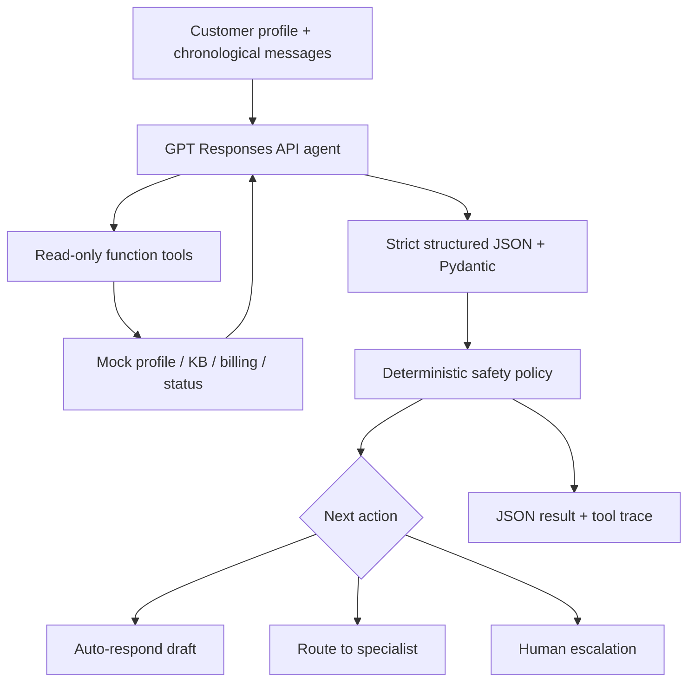

# Support Ticket Triage Agent

> **Ooca AI Engineer take-home assignment** · Python CLI · GPT + real function calling · read-only mock tools · safety-gated triage.

[](https://github.com/thanithpol2545/support-ticket-triage-agent/actions/workflows/tests.yml)

## 1. Purpose and assignment coverage

An AI agent that reads an **entire chronological customer-support ticket**, investigates relevant facts using tools, and recommends an appropriate support action. The original Word assignment is the source of truth; this table maps each requirement to implementation.

| Original requirement | Implementation | Verification |
|---|---|---|
| Classify urgency into **exactly** `critical / high / medium / low` | `Urgency` constrained type + decision policy | `tests/test_models.py`, `tests/test_policy.py` |
| Extract **product, issue type, customer sentiment** | `AgentProposal` and `TriageResult` Pydantic models | Schema and CLI tests |
| Search knowledge base for relevant **FAQs/docs** | `search_knowledge_base`, scored keyword retrieval of mock articles | `tests/test_tools.py` |
| Choose **auto-respond / route to specialist / escalate to human** | `Action` constrained type + deterministic safety policy | `tests/test_policy.py` |
| Use **at least two tools** | GPT is forced to invoke `get_customer_history`, then `search_knowledge_base`; optional billing/status tools | `tests/test_agent.py` verifies function calls and returned tool results |
| Working code on supplied tickets | CLI with three verbatim chronological threads | `python -m triage_agent --mode demo --all` |
| System prompt | `src/triage_agent/prompts/system.md` | Tracked in Git |
| Tool schemas + implementation (may be mocked) | `src/triage_agent/tools.py` | Contract tests |
| One-page architecture / failures / production evaluation | `docs/architecture.md` | Reviewer write-up |
| README with setup/run instructions; GitHub source | This repository | Quick Start below |

**Scoring criteria:** readability, maintainability, extensibility and logic. **No chat UI is required**; the terminal interface is intentional.

## 2. What is implemented (and what is not)

- **Live GPT mode:** uses OpenAI **Responses API**, function calling, structured JSON schema, Pydantic validation and safety policy. It requires `OPENAI_API_KEY` and network access. It has **not been live-verified with a real API key in this environment**.
- **Typhoon comparison mode:** optional **Chat Completions** function-call adapter for development testing. It does **not** substitute for the assignment-required OpenAI GPT mode. Tests with an injected fake client do **not** prove access to the real Typhoon API.
- **Demo mode:** fully deterministic, works **offline without an API key**, uses the same read-only local tools and deterministic safety policy. Demo outputs **are not GPT outputs** and are marked `"mode": "demo_rules"`.
- Four read-only mock tools: customer history, FAQ/KB lookup, billing status and system status. **No real charge/refund/incident** is executed or verified.
- Supports English and Thai customer messages; simple Thai keyword support in the local KB. GPT handles language understanding in live mode.
- Auto-respond, route and escalate are **recommendations/drafts only**; no real messages are sent.

## 3. Quick Start

Python **3.11+** is recommended. No Docker, DB server or UI is required.

```bash
git clone https://github.com/thanithpol2545/support-ticket-triage-agent.git
cd support-ticket-triage-agent
python -m venv .venv
```

Activate on **Windows PowerShell**:

```powershell
.\.venv\Scripts\Activate.ps1
```

Or on **macOS/Linux**:

```bash
source .venv/bin/activate
```

Install:

```bash
python -m pip install -e ".[dev]"
```

Run all three original tickets **without any API key**:

```bash
python -m triage_agent --mode demo --all --no-trace
```

Run one sample with full tool trace:

```bash
python -m triage_agent --mode demo --ticket TICKET-002
```

Save the sample results:

```bash
python -m triage_agent --mode demo --all --output sample_outputs/demo_results.json
```

### Live GPT mode

Use an API key **from your own OpenAI account or a key supplied by the reviewer**. **Never commit it.**

**Windows PowerShell**:

```powershell
$env:OPENAI_API_KEY="YOUR_OWN_KEY"
$env:OPENAI_MODEL="gpt-4.1-mini"
python -m triage_agent --mode live --all
```

**macOS/Linux**:

```bash
export OPENAI_API_KEY="YOUR_OWN_KEY"
export OPENAI_MODEL="gpt-4.1-mini"
python -m triage_agent --mode live --all
```

`OPENAI_MODEL` can be changed to a compatible GPT model accessible to your account. `.env.example` documents the variables; the app reads **environment variables directly** and does not automatically load `.env`.

### Optional Typhoon evaluation (not a replacement for OpenAI GPT)

Typhoon documents its OpenAI-compatible Chat Completions endpoint at `https://api.opentyphoon.ai/v1` and model `typhoon-v2.5-30b-a3b-instruct`. Its request format differs from the OpenAI GPT **Responses API** used for the assignment, so a separate adapter lives in `src/triage_agent/typhoon.py`. Never place a real key in source code, a repository, a GitHub workflow input, an issue, or a test fixture.

**PowerShell** (set key locally, without saving it to the repository):

```powershell
$secureKey = Read-Host "Typhoon API key" -AsSecureString
$env:TYPHOON_API_KEY = [System.Net.NetworkCredential]::new("", $secureKey).Password
Remove-Variable secureKey
python -m triage_agent --mode typhoon --all --no-trace
python scripts/evaluate_typhoon.py --include-edge --limit 12
Remove-Item Env:TYPHOON_API_KEY
```

**Bash**:

```bash
read -rs -p "Typhoon API key: " TYPHOON_API_KEY; echo
export TYPHOON_API_KEY
python -m triage_agent --mode typhoon --all --no-trace
python scripts/evaluate_typhoon.py --include-edge --limit 12
unset TYPHOON_API_KEY
```

The optional evaluation fixture includes the 3 supplied tickets and 9 synthetic boundary cases. The harness reports predicted labels, decisions, tools and policy overrides **without printing the key**. Synthetic labels are proposed test expectations rather than certified production ground truth. A provider call can fail if the model/account does not support the requested forced tool choice; do not treat that as a successful classification. No live Typhoon request was completed in the review runtime because outbound DNS was unavailable.

**Alternative network-enabled test:** In GitHub, configure **Settings → Secrets and variables → Actions → New repository secret** named `TYPHOON_API_KEY` (use a newly generated key). Then open **Actions → typhoon-real-api-smoke → Run workflow**. The manual workflow uses the repository secret, not a public workflow input, and runs three real-provider sample tickets by default. Do not place credentials into the Run Workflow form.

### Tests

```bash
python -m pytest -q
```

The test suite uses **fake OpenAI/Typhoon clients** to validate function-call orchestration without credentials. `tests/test_e2e_regression.py` exercises all 9 synthetic edge cases through the actual CLI, plus Thai/English negations, true incidents, single-user failures and input errors. This is **not** a live API integration test.

Latest local verification (Python 3.13.5, 2026-11-18): **71 tests passed, 92% statement coverage**; the three supplied tickets and all 9 synthetic cases passed the offline/demo acceptance checks (**12/12**). These are engineering test fixtures, not a statistically representative model accuracy evaluation. Run `python -m pytest -q` to reproduce the test count on your machine; coverage requires the optional local `pytest-cov` package.

### Custom ticket input

```bash
python -m triage_agent --mode demo --ticket-file my_ticket.json
python -m triage_agent --mode live --ticket-file my_ticket.json
```

`my_ticket.json` is a single `Ticket` object or a non-empty array of `Ticket` objects (see `src/triage_agent/data/tickets.json`). Empty arrays, malformed tickets and unknown ticket IDs return a non-zero exit code rather than generating a misleading successful result.

## 4. Architecture



Two mandatory tool calls are explicitly requested through `tool_choice`, first `get_customer_history`, then `search_knowledge_base`. The model may invoke billing or status tools before returning its structured proposal. The resulting proposal is always checked by `finalize()`; policy can **raise urgency and escalate**, reject invented KB references and prevent unsafe auto-responses. It cannot make a refund or outage diagnosis true.

### Tool inventory

| Tool | Input | Source / safety |
|---|---|---|
| `get_customer_history` | `customer_id` | Current ticket's mock profile, customer ID restricted |
| `search_knowledge_base` | `query` | Ranked local JSON FAQs with verifiable `KB-*` article IDs |
| `check_billing_status` | `customer_id` | Mock record only; **bank-side charges unverified** |
| `check_system_status` | `region` | Mock public status and regional diagnostics, no confirmed incident |

Tool definitions use strict JSON function schemas; every invocation is recorded with its arguments, result and success status. All tools are **read-only**, validate arguments and reject unknown tools. There is a maximum model/tool round limit.

### Output contract (excerpt)

```json
{
  "ticket_id": "TICKET-002",
  "urgency": "critical",
  "product": "Enterprise platform",
  "issue_types": ["http_500", "access_failure"],
  "sentiment": "frustrated",
  "action": "escalate_to_human",
  "assigned_team": "Infrastructure / On-call",
  "kb_article_ids": ["KB-002"],
  "tools_used": ["get_customer_history", "search_knowledge_base", "check_system_status"],
  "policy_overrides": [],
  "mode": "demo_rules"
}
```

This is an **illustrative excerpt**, not a live model result. Actual output additionally includes `summary`, `reasons`, `draft_response`, `uncertainties` and optionally `tool_trace`.

## 5. Supplied test scenarios and expected behavior

| Case | Description | Target baseline | Rationale |
|---|---|---|---|
| `TICKET-001` | Free user: failed Pro upgrade, repeated reported charges, deadline | **high**, `escalate_to_human`, Billing | Financial dispute must be reviewed; bank/refund state unknown |
| `TICKET-002` | Enterprise, Thailand, 45 seats: multi-user HTTP 500 and client demo | **critical**, `escalate_to_human`, Infrastructure | Broad access failure despite green public status; affected-user count unknown |
| `TICKET-003` | Pro: dark-mode setting malfunction and scheduling idea | **medium**, `route_to_specialist`, Product | Separate confirmed-reported defect from unconfirmed feature availability |

These labels are **proposed test baselines**, not ground truth provided by Ooca. `low` is tested separately for straightforward questions to cover **all four required urgency values**.

## 6. Safety and failure handling

- **Repeated charges:** never assert that money was captured or a refund issued without evidence; escalate to Billing.
- **Enterprise outage:** escalate a multi-user HTTP 500; a green status page is not proof that the tenant is functioning. The enterprise has **45 seats**, not 45 proven affected people.
- **Appearance defects:** route to a specialist if System Default does not work; don't invent scheduled dark-mode availability.
- **Missing/unverified KB:** remove invented article IDs; prohibit automatic answers without grounded documents. Low-risk auto-response uses a **fixed approved FAQ template** only; arbitrary model text is never auto-replied.
- **Tool failure:** fail closed rather than invent a success; malformed KB data returns a tool error and prevents auto-response.
- **Critical:** force human escalation, even if the model suggested only a specialist route.
- **Language variants/negation:** demo and policy share incident detection, including Thai Unicode negations. This protects against simple false positives (e.g., "no duplicate charges", "no HTTP 500") without suppressing confirmed incidents in later clauses. Pattern matching still cannot fully understand natural-language nuance.
- **Single-user failures:** a first failed upgrade or access issue is at least `medium` and routed to a specialist; widespread outages remain `critical`.
- **API failure, malformed JSON, wrong customer ID, max tool rounds:** return a visible error and stop instead of silently fabricating a triage result.
- **Untrusted content:** customer messages and KB passages are data; the system prompt forbids obeying instructions embedded in them. This is a prompt-layer mitigation, not a guarantee against every injection.
- **Privacy:** sample data is hypothetical. In production, redact PII in logs and implement authorization, retention and access controls before connecting real account records.

## 7. Project structure

```text
src/triage_agent/
  __main__.py              # CLI module entry
  cli.py                   # args / JSON / exit codes
  models.py                # Pydantic contracts + JSON schema
  agent.py                 # GPT function-call loop + offline demo
  tools.py                 # four mock tools + schemas
  policy.py                # deterministic escalation safety rules
  prompts/system.md        # AI system prompt
  data/                    # original 3 ticket threads + mock data

tests/                     # model, tool, policy, agent, CLI, E2E regression, adversarial, Typhoon fake-client tests
src/triage_agent/typhoon.py # optional Typhoon evaluation adapter
evaluation/                # proposed synthetic edge-case dataset
scripts/evaluate_typhoon.py # manual real-provider test runner
docs/architecture.md       # assignment-required one-page write-up
docs/qa-review.md          # reviewer-style design risks and acceptance gates
.github/workflows/tests.yml
.env.example
pyproject.toml
```

## 8. Production evaluation and limitations

See `docs/architecture.md` for the **one-page submission write-up**. In a real rollout, use human-labeled ticket sets (including Thai/English), evaluate **critical recall**, macro-F1 for urgency, routing accuracy, unsafe auto-response rate, grounded KB citation rate, tool failure rate, latency and token cost. Review false negatives in critical/billing tickets first. Add confidence-based handoff, monitoring, access control and redaction before production.

**Known limitations:** tiny mock knowledge base, heuristic offline keyword retrieval, three provided sample tickets, no live billing/monitoring integrations, no live OpenAI API call performed in this workspace. Do not infer real-world reliability from the local unit test count.

## 9. Submission checklist

- [x] All five assignment functional requirements represented in runnable code
- [x] Three original chronological sample ticket fixtures
- [x] OpenAI GPT tool-calling implementation, no API key embedded
- [x] Version-controlled system prompt and function tool schemas
- [x] CLI, Pydantic validation, deterministic safeguards and offline tests
- [x] One-page architecture / risks / production evaluation write-up
- [x] Full-path regression tests for original tickets, 9 additional synthetic cases, Thai/English negation, empty inputs and safe provider errors
- [ ] **Live API smoke test with an authorized `OPENAI_API_KEY`**
- [ ] **Real Typhoon provider smoke test** (optional; requires network and user-managed key)
- [ ] Confirm reviewer access to private GitHub repository

---

**Documentation sources:** [OpenAI function calling](https://developers.openai.com/api/docs/guides/function-calling) · [Structured outputs](https://developers.openai.com/api/docs/guides/structured-outputs)