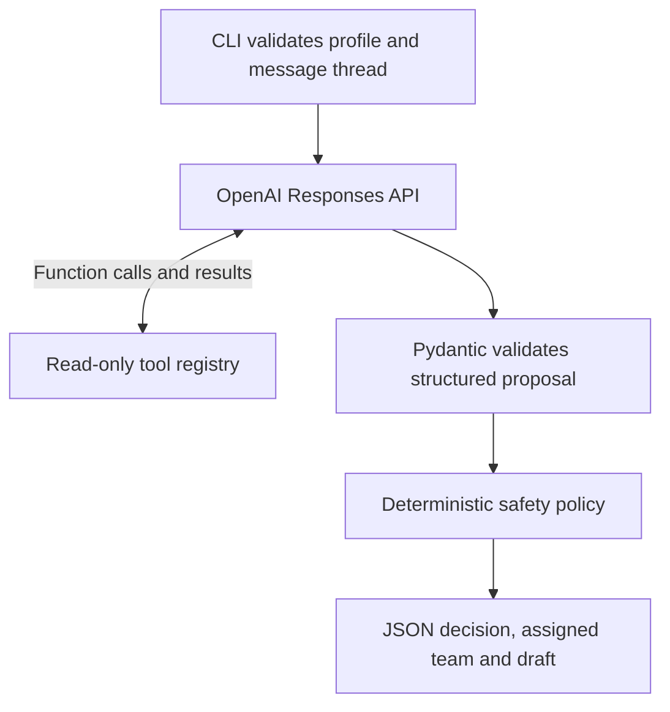

# Support Ticket Triage Agent

> **Ooca AI Engineer take-home assignment** · Python CLI · GPT + real function calling · read-only mock tools · safety-gated triage.

[](https://github.com/thanithpol2545/support-ticket-triage-agent/actions/workflows/tests.yml)

## 1. Purpose and assignment coverage

An AI agent that reads an **entire chronological customer-support ticket**, investigates relevant facts using tools, and recommends an appropriate support action. The original Word assignment is the source of truth; this table maps each requirement to implementation.

| Original requirement | Implementation | Verification |
|---|---|---|
| Classify urgency into **exactly** `critical / high / medium / low` | `Urgency` constrained type + decision policy | `tests/test_models.py`, `tests/test_policy.py` |
| Extract **product, issue type, customer sentiment** | `AgentProposal` and `TriageResult` Pydantic models | Schema and CLI tests |
| Search knowledge base for relevant **FAQs/docs** | `search_knowledge_base`, scored keyword retrieval of mock articles | `tests/test_tools.py` |
| Choose **auto-respond / route to specialist / escalate to human** | `Action` constrained type + deterministic safety policy | `tests/test_policy.py` |
| Use **at least two tools** | GPT is forced to invoke `get_customer_history`, then `search_knowledge_base`; optional billing/status tools | `tests/test_agent.py` verifies function calls and returned tool results |
| Working code on supplied tickets | CLI with three verbatim chronological threads | `python -m triage_agent --all` |
| System prompt | `src/triage_agent/prompts/system.md` | Tracked in Git |
| Tool schemas + implementation (may be mocked) | `src/triage_agent/tools.py` | Contract tests |
| One-page architecture / failures / production evaluation | `docs/architecture.md` | Reviewer write-up |
| README with setup/run instructions; GitHub source | This repository | Quick Start below |

**Scoring criteria:** readability, maintainability, extensibility and logic. **No chat UI is required**; the terminal interface is intentional.

## 2. Runtime

Every ticket goes through the OpenAI Responses API with function calling and strict structured output. Pydantic validates the proposal, and Python safety rules check the resulting decision. Running the CLI on tickets requires an authorized `OPENAI_API_KEY` and network access.

The four read-only mock tools provide account history, FAQ search, billing status and system status. The agent reads English and Thai ticket threads. The output is a recommendation and draft for support staff. Mock records cannot verify a real charge, refund or incident.

**Authenticated OpenAI: NOT VERIFIED.** The test suite exercises the real CLI, adapter, tools and policy with simulated OpenAI responses. [QA report](docs/qa-review.md)

## 3. Quick Start

Python **3.11+** is recommended. No Docker, DB server or UI is required.

```bash
git clone https://github.com/thanithpol2545/support-ticket-triage-agent.git
cd support-ticket-triage-agent
python -m venv .venv
```

Activate on **Windows PowerShell**:

```powershell
.\.venv\Scripts\Activate.ps1
```

Or on **macOS/Linux**:

```bash
source .venv/bin/activate
```

Install:

```bash
python -m pip install -e ".[dev]"
```

### OpenAI key and model

Use a key from your OpenAI account or one authorized by the reviewer. Keep it out of Git.

**Windows PowerShell**

```powershell
$secureKey = Read-Host "OpenAI API key" -AsSecureString
$env:OPENAI_API_KEY = [System.Net.NetworkCredential]::new("", $secureKey).Password
Remove-Variable secureKey
```

**Bash on macOS/Linux**

```bash
read -rs -p "OpenAI API key: " OPENAI_API_KEY
echo
export OPENAI_API_KEY
```

The model defaults to `gpt-4.1-mini`. Set the optional `OPENAI_MODEL` environment variable to a compatible GPT model your account can access. [Environment variable reference](.env.example)

The CLI reads the shell environment directly. After you finish, clear the key with `Remove-Item Env:OPENAI_API_KEY` in PowerShell or `unset OPENAI_API_KEY` in Bash.

OpenAI has announced retirement of the `gpt-4.1-mini-2025-04-14` snapshot on January 14, 2027. Check the provider's model lifecycle before choosing a deployment model. [OpenAI deprecations](https://developers.openai.com/api/docs/deprecations)

### Run triage

```bash
python -m triage_agent --all
triage-agent --ticket TICKET-002
python -m triage_agent --ticket-file tickets.json
```

Running either entry point without a ticket selection processes the first sample. The three selection options are mutually exclusive. `tickets.json` accepts a single `Ticket` object or a non-empty array, using the same structure as the [sample tickets](src/triage_agent/data/tickets.json). A missing key, malformed input or unknown sample ID returns exit code 2 with an error on stderr.

Use `--no-trace` to omit tool arguments and results. Use `--output` to also save the same JSON to a UTF-8 file.

```bash
python -m triage_agent --all --no-trace --output results.json
```

### Tests

```bash
python -m pytest -q
```

The tests use fake OpenAI clients and an SDK mock transport. They exercise both required tools, all nine synthetic edge cases, scoped outages, multilingual negation, refund disputes and CLI failures. They verify the application and safety policy under simulated responses. [QA report](docs/qa-review.md)

## 4. Architecture



### How a ticket is judged

The [system prompt](src/triage_agent/prompts/system.md) asks the model to read the whole conversation and weigh impact, breadth, time pressure and how the problem develops. It recommends **critical** for widespread outages or major business interruption, **high** for repeated charges, disputes or major access problems, **medium** for defects with partial usability, and **low** for routine questions or nonurgent suggestions. Anger alone does not establish critical urgency. The model proposes the product, issue types, sentiment, urgency, action and team. The [schema](src/triage_agent/models.py) checks the shape and allowed values. The policy below decides which parts of the proposal can stand.

The GPT adapter requires a successful customer history lookup followed by a KB search. Billing and regional status lookups are optional model choices. KB retrieval counts matching keywords in the local [FAQ catalog](src/triage_agent/data/kb.json) and returns up to three articles with IDs and excerpts as evidence. The [sample tickets](src/triage_agent/data/tickets.json) and [edge cases](evaluation/adversarial_cases.json) supply inputs and evaluation expectations. They do not train the model or assign a decision to a new ticket.

**Incident rules, in priority order.** A minimum urgency preserves a higher proposed urgency. The first matching row determines the incident-specific handling. The final action rules below then apply to every ticket. See the exact English and Thai patterns in [policy.py](src/triage_agent/policy.py).

| Condition in the ticket thread | Urgency and handoff |
|---|---|
| Multiple people are reported to have the same access failure, outage or HTTP 500. A follow-up such as “my coworkers get the same error” can establish scope. | Set `critical`, `escalate_to_human`, Infrastructure / On-call. If a billing dispute or repeated charge also matches, keep Infrastructure as owner and flag Billing review in the draft. |
| Repeated charges, chargeback or a refund dispute, including a refund denial followed by an appeal. A refund-status inquiry alone does not trigger this rule. | At least `high`. Force `escalate_to_human` to Billing Support. Leave settlement and refund status unconfirmed. |
| A message mentions “dark mode” and a recognized defect phrase, without a recognized third-party reference in that message. | At least `medium`. Convert an automatic reply to a specialist route. Specialist routes go to Product Support. A separate scheduling request adds an uncertainty when the scheduling phrase matches. |
| An individual access failure or an unsuccessful payment or upgrade. | At least `medium`. Convert an automatic reply to a specialist route. Access goes to Technical Support and payment goes to Billing Support. Access takes priority when both match. |
| No incident rule matches. | The model proposal proceeds to the final checks. |

**Scope changes the decision.** “HTTP 500 affects all users” triggers the outage rule. “I get HTTP 500. Everyone else can log in” triggers the individual access rule. “No HTTP 500 occurred. Everyone can log in” triggers neither. The patterns check selected negations, contrast clauses and follow-up reports. The “affects / is affecting” pattern also checks whether the clause is a question or a denied belief. Seat count and a green public status do not establish how many customers are affected. [Outage regression cases](tests/test_e2e_regression.py)

**Final action rules.** Citation filtering happens before incident handling. The remaining checks use the urgency and action after incident handling.

| Condition | Final behavior |
|---|---|
| A proposed citation was never returned by a successful KB search, or is duplicated | Remove unknown IDs and duplicates. Retain the Appearance FAQ (`KB-003`) only for an affirmed appearance topic. |
| `critical` with any action other than human escalation | Force `escalate_to_human` to Support Escalation. Existing escalations keep their assigned team. |
| `high` or `medium` still proposes `auto_respond` | High escalates to Support Escalation. Medium routes to General Support. A high specialist route can stand when no incident rule forces escalation. |
| `low / auto_respond` | Use the first approved, retained FAQ template and cite only its article. `KB-003` gives Appearance guidance and `KB-004` asks for clarification. If neither is available or any recorded tool call failed, route to General Support. |
| A handoff has no assigned team | Assign General Support. Other surviving proposals keep their action and team. |
| Invalid input, provider error, unsuccessful required model tool call, invalid final proposal or exhausted model rounds | Stop with a CLI error instead of emitting a successful batch. The model loop defaults to eight rounds. |

The JSON records successful tool names in `tools_used` and policy reason codes in `policy_overrides`. The optional full trace includes arguments, results and failures. Human handoffs produce drafts for staff review. Only the automatic reply path guarantees an approved FAQ template.

### Tool inventory

| Tool | Input | Source / safety |
|---|---|---|
| `get_customer_history` | `customer_id` | Current ticket's mock profile, customer ID restricted |
| `search_knowledge_base` | `query` | Ranked local JSON FAQs with verifiable `KB-*` article IDs |
| `check_billing_status` | `customer_id` | Mock record only; **bank-side charges unverified** |
| `check_system_status` | `region` | Mock public status and regional diagnostics, no confirmed incident |

Tool definitions use strict JSON function schemas; every invocation is recorded with its arguments, result and success status. All tools are **read-only**, validate arguments and reject unknown tools. There is a maximum model/tool round limit.

### Output contract

`--all` and `--ticket-file` return an array. Selecting one sample by ID or using the default selection returns a single object.

| Fields | Meaning |
|---|---|
| `ticket_id`, `product`, `issue_types`, `sentiment` | The input ID and structured extraction |
| `urgency`, `action`, `assigned_team` | The final decision and handoff team, if applicable |
| `summary`, `reasons`, `draft_response`, `uncertainties` | Evidence, response draft and open questions |
| `kb_article_ids`, `tools_used`, `policy_overrides` | Retained citations, successful tool names and safety adjustments |
| `tool_trace` | Tool arguments, results and success flags. Omitted by `--no-trace`. |

## 5. Supplied test scenarios and expected behavior

| Case | Description | Target baseline | Rationale |
|---|---|---|---|
| `TICKET-001` | Free user: failed Pro upgrade, repeated reported charges, deadline | **high**, `escalate_to_human`, Billing | Financial dispute must be reviewed; bank/refund state unknown |
| `TICKET-002` | Enterprise, Thailand, 45 seats: multi-user HTTP 500 before a client event | **critical**, `escalate_to_human`, Infrastructure | Broad access failure despite green public status; affected-user count unknown |
| `TICKET-003` | Pro: dark-mode setting malfunction and scheduling idea | **medium**, `route_to_specialist`, Product | Separate confirmed-reported defect from unconfirmed feature availability |

These labels are **proposed test baselines**, not ground truth provided by Ooca. `low` is tested separately for straightforward questions to cover **all four required urgency values**.

## 6. Safety and failure handling

- **Repeated charges:** never assert that money was captured or a refund issued without evidence; escalate to Billing.
- **Enterprise outage:** escalate a multi-user HTTP 500; a green status page is not proof that the tenant is functioning. The enterprise has **45 seats**, not 45 proven affected people.
- **Appearance defects:** route to a specialist if System Default does not work; don't invent scheduled dark-mode availability.
- **Missing/unverified KB:** discard invented article IDs and Appearance citations for unrelated tickets. Low-risk auto-response uses an approved template. The general template asks for clarification.
- **Tool failure:** fail closed rather than invent a success; malformed KB data returns a tool error and prevents auto-response.
- **Critical:** force human escalation, even if the model suggested only a specialist route.
- **Language variants and scope:** the safety policy checks English and Thai incident evidence. Affirmative group impact, including an explicit follow-up about the same error, is required for a multi-user outage. The heuristics cover selected phrasing. Review ambiguous reports and model outputs on labeled data.
- **Single-user failures:** a first failed upgrade or access issue is at least `medium` and routed to a specialist; widespread outages remain `critical`.
- **API failure, malformed JSON, wrong customer ID, max tool rounds:** return a visible error and stop instead of silently fabricating a triage result.
- **Untrusted content:** customer messages and KB passages are data; the system prompt forbids obeying instructions embedded in them. This is a prompt-layer mitigation, not a guarantee against every injection.
- **Privacy:** schema diagnostics omit raw validation values. Full traces and result fields may include customer data. `--no-trace` omits tool arguments and results. Before connecting real account records, implement authorization, access controls, redaction and retention.

## 7. Project structure

```text
src/triage_agent/
  __main__.py              # CLI module entry
  cli.py                   # args / JSON / exit codes
  models.py                # Pydantic contracts + JSON schema
  agent.py                 # GPT Responses API function-call loop
  tools.py                 # four mock tools + schemas
  policy.py                # deterministic escalation safety rules
  prompts/system.md        # AI system prompt
  data/                    # original 3 ticket threads + mock data

tests/                     # contracts, tool rules and OpenAI-mocked integration tests
evaluation/                # synthetic edge cases and their expected decisions
docs/architecture.md       # assignment-required one-page write-up
docs/qa-review.md          # reviewer-style design risks and acceptance gates
.github/workflows/tests.yml
.env.example
pyproject.toml
```

## 8. Production evaluation and limitations

See `docs/architecture.md` for the **one-page submission write-up**. In a real rollout, use human-labeled ticket sets (including Thai/English), evaluate **critical recall**, macro-F1 for urgency, routing accuracy, unsafe auto-response rate, grounded KB citation rate, tool failure rate, latency and token cost. Review false negatives in critical/billing tickets first. Add confidence-based handoff, monitoring, access control and redaction before production.

**Known limitations:** tiny mock knowledge base, keyword-based FAQ retrieval, three provided sample tickets, no live billing/monitoring integrations, no live OpenAI API call performed in this workspace. Do not infer real-world reliability from the local unit test count.

## 9. Submission checklist

- [x] All five assignment functional requirements represented in runnable code
- [x] Three original chronological sample ticket fixtures
- [x] OpenAI GPT tool-calling implementation, no API key embedded
- [x] Version-controlled system prompt and function tool schemas
- [x] CLI, Pydantic validation, deterministic safeguards and offline tests
- [x] One-page architecture / risks / production evaluation write-up
- [x] Full-path regression tests for original tickets, 9 additional synthetic cases, Thai/English negation, empty inputs and safe provider errors
- [ ] **Live API smoke test with an authorized `OPENAI_API_KEY`**
- [ ] Confirm reviewer access to private GitHub repository

---

**Documentation sources:** [OpenAI function calling](https://developers.openai.com/api/docs/guides/function-calling) · [Structured outputs](https://developers.openai.com/api/docs/guides/structured-outputs)
